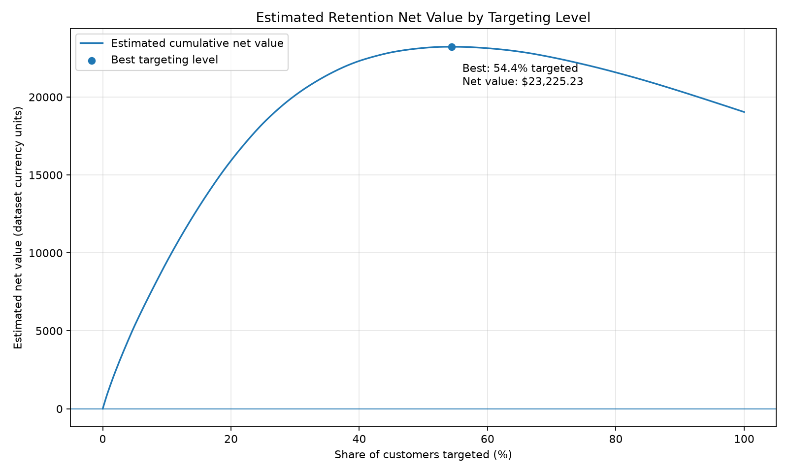

# Churn Retention & ROI Analysis

**Business Analytics · Customer Retention · SQL · Python · LibreOffice Calc**

## 1. Business Problem

A business may identify customers who are likely to churn, but contacting every at-risk customer can waste retention-offer budget. This project evaluates how customer churn risk, offer cost, offer success rate, and retention duration affect estimated financial value.

The objective is to identify customers worth prioritizing for a retention offer and understand how sensitive the estimated returns are to uncertain business assumptions.

## 2. Data and Provenance

The churn prediction model and original Telco Customer Churn dataset come from my companion project: [Customer Churn MLOps](https://github.com/Ritik0835/customer-churn-mlops).

This repository uses customer-level churn probabilities and held-out test-set outcomes exported from that project. The analysis contains 1,409 customers, with 374 observed churners in the test set.

**Important:** Monthly charges are used as a proxy for monthly revenue. They are not verified profit or realized revenue retained. No actual retention-offer experiment was conducted.

## 3. Approach

- **SQL:** Created a customer scoring table, checked data quality, segmented customers into risk deciles, and calculated churners per decile.
- **Window functions:** Used `NTILE(10)` to assign risk deciles and running sums to calculate cumulative churn capture.
- **Spreadsheet analysis:** Reconciled decile-level churner counts between SQL and a LibreOffice Calc pivot table.
- **Python:** Compared targeting strategies, calculated estimated net value, generated a cumulative net-value curve, and performed sensitivity analysis.
- **Business interpretation:** Documented assumptions, break-even considerations, limitations, and recommended next steps.

## 4. Financial Assumptions

The base scenario uses illustrative inputs:

| Input | Base assumption |
|---|---:|
| Offer success rate | 20% |
| Offer cost per targeted customer | $10 |
| Retention period | 6 months |
| Monthly customer value proxy | Monthly charges |

Estimated net value per customer:

`Churn probability × offer success rate × monthly charges × retention months − offer cost`

These inputs are scenario assumptions, not measured treatment effects. See [`docs/assumptions.md`](docs/assumptions.md) and [`docs/roi_formula.md`](docs/roi_formula.md).

## 5. Key Results

- **Dataset:** 1,409 held-out test-set customers.
- **Observed churners:** 374, approximately 26.5%.
- **Top-20% risk targeting:** 282 customers.
- **Estimated net value for top-20% risk targeting:** $14,806.65 under the base assumptions.
- **Positive expected-value customers:** 766, or approximately 54.4% of the test set.
- **Maximum estimated net value on the cumulative curve:** $23,225.23 when targeting those 766 positive-value customers.

These are model-based estimates under the stated assumptions, not realized profits. The cumulative curve evaluates the same assumed per-customer value formula as the targeting threshold changes.

## 6. Chart and Analysis Files

### Cumulative net-value curve

The curve helps identify where adding more customers stops increasing estimated net value. Under the base assumptions, customers with non-positive expected value reduce the cumulative total when included.

### Sensitivity analysis

The sensitivity table varies offer success rate and offer cost to show how estimated net value changes under different scenarios.

- [Sensitivity table CSV](data/sensitivity_table.csv)
- [Strategy comparison](docs/strategy_comparison.md)
- [Break-even analysis](docs/break_even_analysis.md)
- [Assumptions](docs/assumptions.md)
- [ROI formula](docs/roi_formula.md)
- [Limitations](docs/limitations.md)
- [SQL cumulative gain analysis](sql/05_cumulative_gain.sql)
- [Decile reconciliation workbook](excel/churn_decile_reconciliation.xlsx)

## 7. Limitations

The analysis does not use a randomized retention-offer holdout. Churn probability does not tell us whether a customer will change their behavior because of an offer. Offer success rate, offer cost, and retention duration are assumed, while monthly charges are only a revenue proxy.

Consequently, actual incremental retention and profit remain unknown. The next step is a randomized experiment, followed by uplift modeling when sufficient treatment and control data are available.

See [`docs/limitations.md`](docs/limitations.md) for details.

## 8. Tools

PostgreSQL · SQL window functions · Python · pandas · matplotlib · scikit-learn model outputs · LibreOffice Calc · Git and GitHub

## 9. Repository Purpose

This project demonstrates an end-to-end business analytics workflow: turning churn predictions into customer targeting scenarios, reconciling SQL results with a spreadsheet, and communicating financial trade-offs and uncertainty to decision-makers.
